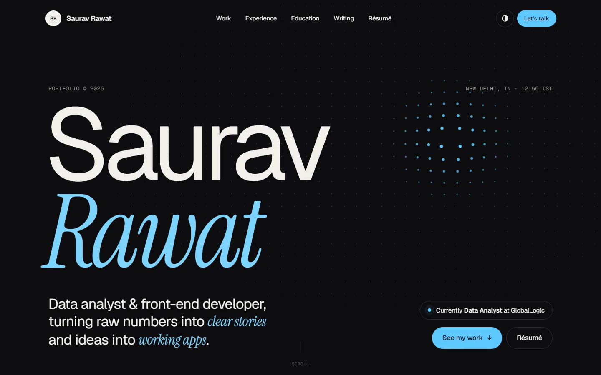
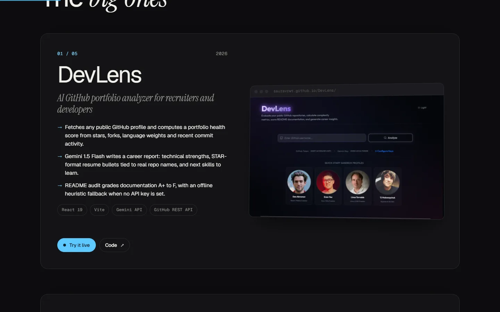
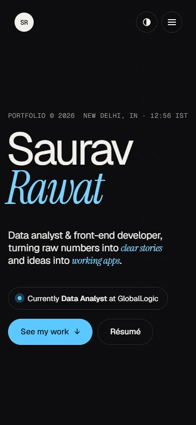
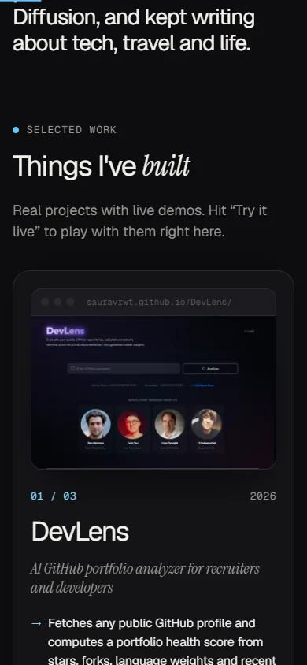

<div align="center">

# Saurav Rawat — Portfolio

**Data Analyst at GlobalLogic · React front-end developer · Published researcher**

[**Live site →**](https://sauravrwt.github.io) &nbsp;·&nbsp; [LinkedIn](https://www.linkedin.com/in/SauRavRwT) &nbsp;·&nbsp; [Email](mailto:souravrawat142@gmail.com)

[](https://github.com/SauRavRwT/sauravrwt.github.io/actions/workflows/nodejs.yml)


<picture>
  <source media="(prefers-color-scheme: light)" srcset=".github/assets/home-light.webp" />
  
</picture>

</div>

## About

A fast, animated, fully responsive portfolio that shows real work instead of describing it. Every project card links to a working build — and most of them can be **played with right inside the page**.

Everything on the site is driven by two files: [`src/portfolio.js`](src/portfolio.js) for content and [`src/theme.js`](src/theme.js) for colours.

## Highlights

|                         |                                                                                                                                                                       |
| ----------------------- | --------------------------------------------------------------------------------------------------------------------------------------------------------------------- |
| **Live demos in-page**  | “Try it live” opens the deployed project in a browser frame without leaving the site.                                                                                 |
| **Scroll storytelling** | Case studies stack as you scroll, a pinned horizontal timeline walks through education and work, and the About paragraph lights up word by word.                      |
| **Interactive hero**    | A dot field that reacts to the cursor, a live New Delhi clock, and a skippable intro.                                                                                 |
| **Smooth everywhere**   | Inertia scrolling with [Lenis](https://github.com/darkroomengineering/lenis), spring-based animation with [Motion](https://motion.dev), smooth light/dark cross-fade. |
| **One-file theming**    | Six built-in palettes, each with a dark and light mode. Colours are baked into `index.html` at build time, so there is no flash on load.                              |
| **Honest numbers**      | Stats and the timeline are computed from the data files — nothing is hard-coded.                                                                                      |
| **Responsive**          | Tested from 320 px phones and landscape phones to 1366×768 laptops and 1920 px monitors.                                                                              |
| **Accessible**          | Respects `prefers-reduced-motion`, full keyboard navigation, skip link, semantic headings.                                                                            |
| **Fast**                | Pages are code-split; the PDF viewer only loads on the Résumé page.                                                                                                   |

## Screenshots

<table>
  <tr>
    <td width="58%"></td>
    <td></td>
    <td></td>
  </tr>
</table>

## Tech stack

- **[React 18](https://react.dev)** with **[React Router](https://v5.reactrouter.com)**
- **[Vite](https://vite.dev)** for dev server and builds
- **[Motion](https://motion.dev)** for animation, **[Lenis](https://github.com/darkroomengineering/lenis)** for smooth scrolling
- **[react-pdf](https://github.com/wojtekmaj/react-pdf)** for the in-page résumé
- Plain CSS with custom properties — no CSS framework
- Hosted on **GitHub Pages**, built by **GitHub Actions**

## Getting started

Requires **Node.js 22+**.

```bash
git clone https://github.com/SauRavRwT/sauravrwt.github.io.git
cd sauravrwt.github.io
npm install
npm start          # dev server on http://localhost:3000
```

| Script               | What it does                                       |
| -------------------- | -------------------------------------------------- |
| `npm start`          | Start the dev server with hot reload               |
| `npm run build`      | Production build into `dist/`                      |
| `npm run preview`    | Serve the production build locally                 |
| `npm run deploy`     | Build and publish `dist/` to the `gh-pages` branch |
| `npm run fetch-data` | Refresh pinned GitHub repos (see below)            |
| `npm run format`     | Format the code with Prettier                      |

## Make it yours

### Change the theme

Open [`src/theme.js`](src/theme.js) and pick a palette:

```js
export const chosenTheme = themes.ocean; // lime · ocean · sunset · violet · mint · mono
export const defaultMode = "dark"; // what first-time visitors see
```

Each palette defines a dark and a light mode; visitors can switch with the toggle in the navbar. To create your own, copy any palette and change the `accent`, `accentText` and `onAccent` values (and the neutral surfaces at the top of the file if you like).

### Change the content

All text lives in [`src/portfolio.js`](src/portfolio.js):

| Export                                          | Used for                                        |
| ----------------------------------------------- | ----------------------------------------------- |
| `greeting`                                      | Name, About paragraph, résumé and repo links    |
| `featuredProjects`                              | Big case-study cards (Home + Projects)          |
| `moreWork`                                      | Draggable “Playground” gallery                  |
| `experience`                                    | Experience page and timeline                    |
| `degrees`, `certifications`, `competitiveSites` | Education page                                  |
| `blog`                                          | Blog posts, each with its own URL (`/blog/:id`) |
| `skills`                                        | “What I do” cards and the tools marquee         |
| `socialMediaLinks`                              | Footer, Contact page and SEO data               |

Images go in `src/assets/images/` (project screenshots in `src/assets/images/work/`), and the résumé PDF is `src/assets/docs/SAURAV_RAWAT.pdf`.

### Refresh GitHub data

The “Pinned repositories” section reads `src/shared/opensource/projects.json`. To update it:

```bash
cp env.example .env   # add a GitHub token (public read access) and your username
npm run fetch-data
```

## Project structure

```
src/
├── portfolio.js          # all site content
├── theme.js              # colour palettes
├── shared/               # derived stats/timeline + GitHub data
├── assets/               # images, screenshots, résumé PDF, font
└── site/
    ├── Site.jsx          # routes
    ├── themeCss.js       # turns theme.js into CSS variables (used by Vite)
    ├── components/       # Nav, Footer, Layout, project cards, timeline, …
    ├── pages/            # Home, Projects, Experience, Education, Blog, Contact, Résumé
    └── styles/           # design system + page styles
```

## Deployment

The site is a single-page app on GitHub Pages:

1. `npm run deploy` builds the site and pushes `dist/` to the `gh-pages` branch.
2. `public/404.html` redirects deep links (like `/blog/7`) back into the app, so every URL is shareable.
3. GitHub Actions builds every push and pull request to `main` on Node 22 and 24.

## Contact

**Saurav Rawat** — [souravrawat142@gmail.com](mailto:souravrawat142@gmail.com) · [LinkedIn](https://www.linkedin.com/in/SauRavRwT) · [GitHub](https://github.com/SauRavRwT)
